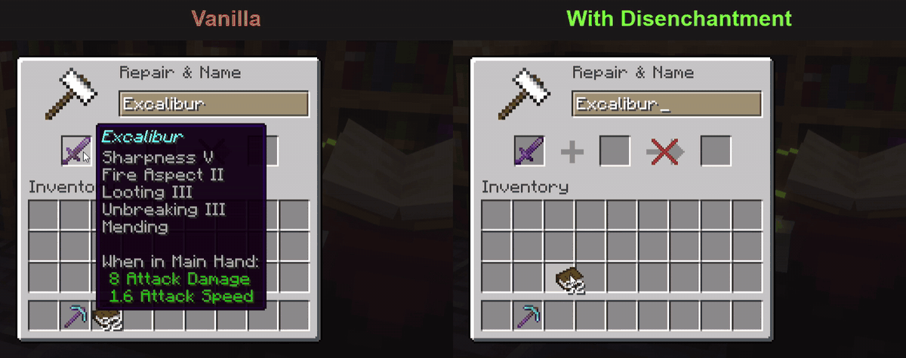
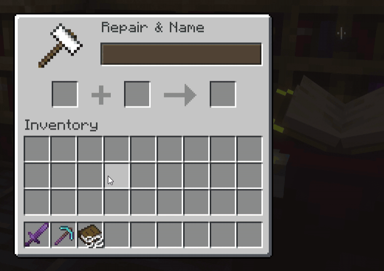
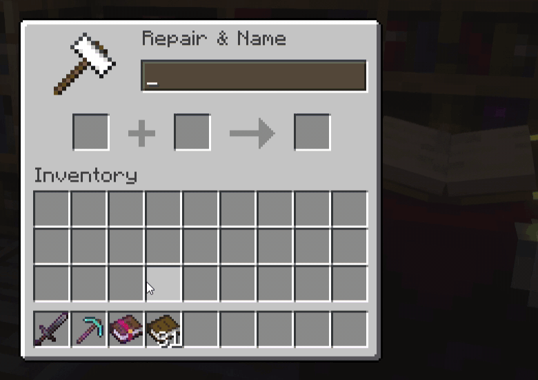
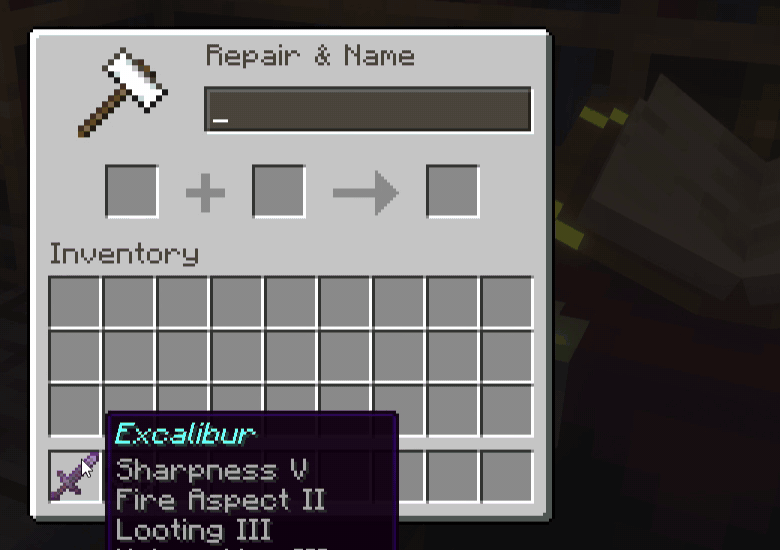
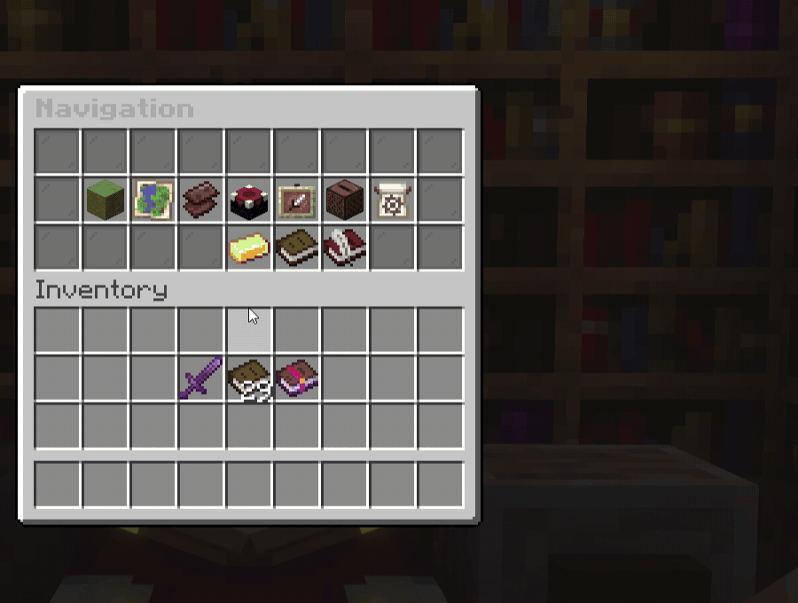
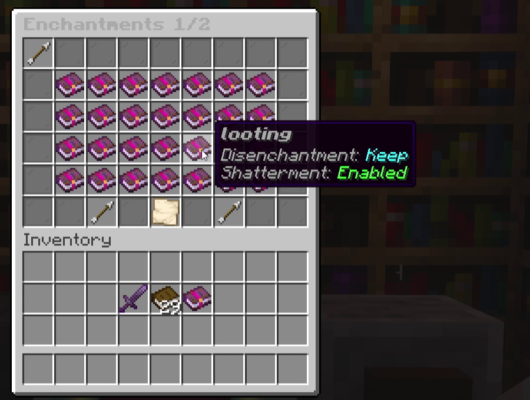
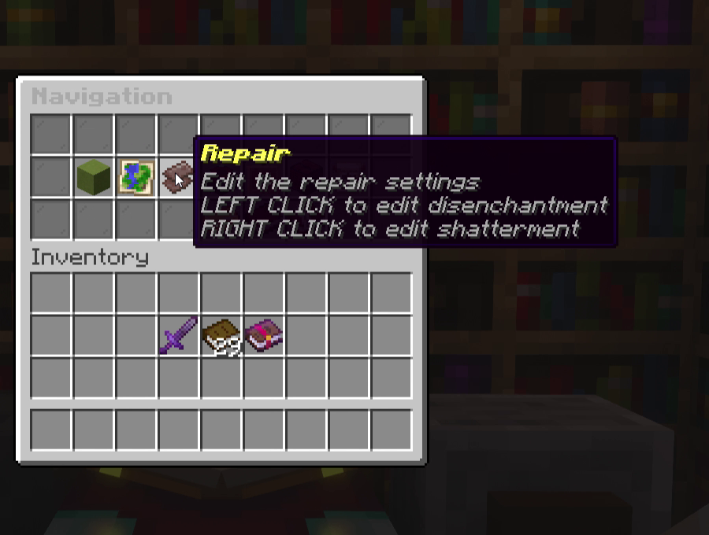
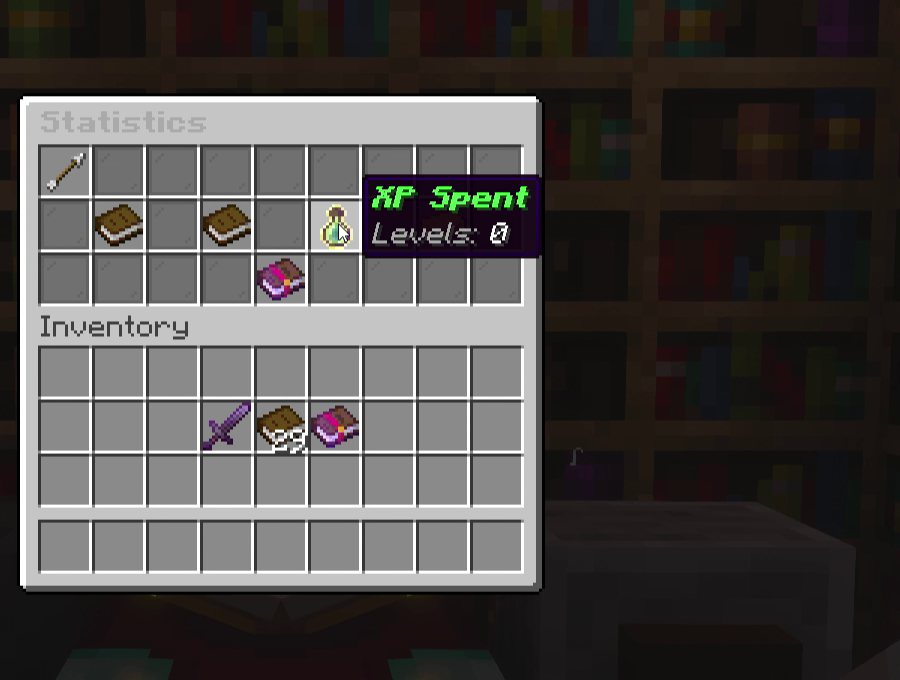

<p align="center">
  
</p>

<p align="center">
  <a href="https://github.com/H7KZ/Disenchantment/releases/latest"></a>
  <a href="LICENSE"></a>
  <a href="https://www.spigotmc.org/resources/110741"></a>
  <a href="https://modrinth.com/plugin/disenchantment"></a>
  <a href="https://www.spigotmc.org/resources/110741"></a>
  <a href="https://bstats.org/plugin/bukkit/Disenchantment/19058"></a>
  <a href="https://bstats.org/plugin/bukkit/Disenchantment/19058"></a>
</p>

**Disenchantment** lets players pull enchantments off items and split enchanted books — using nothing but the vanilla
anvil. No new blocks, no custom menus for players, no resource pack. Drop it in and it just works on Spigot, Paper and
Folia from Minecraft 1.18 to 26.x.

<p align="center">
  
</p>

## Features

### Disenchant items onto books

Put an enchanted item in the first anvil slot and a plain book in the second. Take the result and every enchantment
moves onto the book; the item comes back clean. Works on swords, tools, armor — anything enchantable.

<p align="center">
  
</p>

### Split enchanted books

Put a multi-enchantment book in the first slot and a plain book in the second. One enchantment splits off onto the new
book; the original keeps the rest. Repeat until every enchantment has its own book.

<p align="center">
  
</p>

### Decide what each enchantment does

Every enchantment can be set to **enable** (transfer to the book), **keep** (stay on the item), **delete** (destroyed)
or **disable** (block the operation). Group enchantments together and change a whole group with one command.

<p align="center">
  
</p>

### Configure everything in-game

`/disenchantment gui` opens an admin panel for every setting — worlds, enchantments, materials, XP cost, sounds,
economy, split count and live statistics. Changes save to `config.yml` instantly, no restart.

<p align="center">
  
</p>

### Everything else

- **XP cost formula** — `base + (enchantment level × multiply)`, per-enchantment overrides, a max cost, optional
  "Too Expensive!" bypass and repair-cost reset.
- **Economy** — optional currency cost per operation through Vault or VaultUnlocked, previewed in the action bar.
- **Restrictions** — allowlist or denylist by world and by material, separately for disenchanting and splitting.
- **Success chances** — give individual enchantments a transfer chance; a failed roll destroys that enchantment.
- **Cooldowns** — built-in, or delegated to CMI or EssentialsX.
- **VIP discounts** — XP cost multiplier from LuckPerms meta or `disenchantment.discount.<N>` permissions.
- **Statistics** — optional SQLite log of every operation, browsable in the GUI and via `/disenchantment stats`.
- **Developer API** — cancellable `Pre*`/`Post*` events carrying XP and economy cost, plus PlaceholderAPI placeholders.
- **Custom enchantments** — built-in adapters for seven popular enchantment plugins (see below).
- **Languages** — English and Czech out of the box.

<p align="center">
  
  
  
</p>

## Quick start

1. Download the latest `Disenchantment-<version>.jar` from
   [Modrinth](https://modrinth.com/plugin/disenchantment), [SpigotMC](https://www.spigotmc.org/resources/110741) or
   [GitHub Releases](https://github.com/H7KZ/Disenchantment/releases/latest).
2. Drop it into your server's `plugins/` folder and restart.
3. Done — players can use the anvil right away. Tune it with `/disenchantment gui` or
   `plugins/Disenchantment/config.yml`.

**Requirements:** Spigot, Paper or Folia · Minecraft 1.18 – 26.x · Java 17+ (Java 21+ on 1.20.5 and newer).
Vault, PlaceholderAPI, LuckPerms, CMI and EssentialsX are all optional.

## Supported custom enchantment plugins

| Plugin                                                           | 1.21.8 – 26.x | 1.21.5 – 1.21.7 | 1.21 – 1.21.4 | 1.20.5 – 1.20.6 | 1.18 – 1.20.4 |
|------------------------------------------------------------------|:-------------:|:---------------:|:-------------:|:---------------:|:-------------:|
| [AdvancedEnchantments](https://www.spigotmc.org/resources/43058) |       ✓       |        ✓        |       ✓       |        ✓        |       ✓       |
| [EcoEnchants](https://www.spigotmc.org/resources/79573)          |       ✓       |        ✓        |       ✓       |        ✓        |       ✓       |
| [EnchantsSquared](https://www.spigotmc.org/resources/86747)      |       ✓       |        ✓        |       ✓       |        ✓        |       ✓       |
| [UberEnchant](https://www.spigotmc.org/resources/19448)          |       ✓       |        ✓        |       ✓       |        ✓        |       ✓       |
| [ExcellentEnchants](https://www.spigotmc.org/resources/61693)    |       ✓       |        ✓        |       ✓       |        –        |       –       |
| [Vane](https://modrinth.com/plugin/vane)                         |       ✓       |        ✓        |       ✓       |        –        |       –       |
| [Zenchantments](https://github.com/moikheck/Zenchantments)       |       ✓       |        ✓        |       ✓       |        –        |       –       |

> **Note:** EcoEnchants V13.0.0 is supported natively with Disenchantment 6.4.0+. No patched build is required.

## Commands & permissions

| Command                              | What it does                         | Permission (default)                 |
|--------------------------------------|--------------------------------------|--------------------------------------|
| `/disenchantment gui`                | Open the admin GUI                   | `disenchantment.command.gui` (op)    |
| `/disenchantment toggle`             | Turn the whole plugin on or off      | `disenchantment.command.toggle` (op) |
| `/disenchantment reload`             | Reload `config.yml`                  | `disenchantment.command.reload` (op) |
| `/disenchantment stats`              | Show operation statistics            | `disenchantment.command.stats` (op)  |
| `/disenchantment help`               | List every command                   | `disenchantment.command.help` (op)   |
| *(anvil)* disenchant / split a book  | Use the features at an anvil         | `disenchantment.anvil.all` (everyone)|

Aliases: `/disenchant`. Full lists: [Commands](docs/user/COMMANDS.md) · [Permissions](docs/user/PERMISSIONS.md).

## Documentation

Full documentation lives in [`docs/`](docs/README.md).

| Audience                    | Start here                                                                             |
|-----------------------------|----------------------------------------------------------------------------------------|
| Server admins & players     | [`docs/user/`](docs/user/README.md) — installation, commands, config, permissions, FAQ |
| Plugin developers (API)     | [`docs/api/`](docs/api/README.md) — public events, PlaceholderAPI                      |
| Contributors & engineers    | [`docs/engineering/`](docs/engineering/README.md) — architecture, setup, contributing  |
| Deep internals / LLM agents | [`docs/internals/`](docs/internals/README.md) — NMS, events, GUI, config system        |

**Quick links:** [Configuration](docs/user/CONFIG.md) · [How-To Guide](docs/user/HOW_TO.md) ·
[FAQ](docs/user/FAQ.md) · [API events](docs/api/EVENTS.md) · [Placeholders](docs/api/PLACEHOLDERS.md)

## Building from source

```bash
mvn clean package
```

The output JAR is written to `target/Disenchantment-<version>.jar`. See
[CONTRIBUTING.md](docs/engineering/CONTRIBUTING.md) for prerequisites (Spigot BuildTools) and development setup.

## Contributing

Contributions are welcome! Please read the [Contributing Guidelines](docs/engineering/CONTRIBUTING.md) before opening a
pull request. Bug reports: run `/disenchantment diagnostic` and paste the result into a
[GitHub issue](https://github.com/H7KZ/Disenchantment/issues).

## Links

[Modrinth](https://modrinth.com/plugin/disenchantment) · [SpigotMC](https://www.spigotmc.org/resources/110741) ·
[bStats](https://bstats.org/plugin/bukkit/Disenchantment/19058) · [GitHub](https://github.com/H7KZ/Disenchantment)

Store-page descriptions and media live in [`store/`](store/README.md).

## License

This project is licensed under the [MIT License](LICENSE).

## Dependencies and Attribution

### Bundled Libraries

The following libraries are included in the distributed plugin JAR:

| Library                                             | License | Author            | Purpose                                                                 |
|-----------------------------------------------------|---------|-------------------|-------------------------------------------------------------------------|
| [bStats](https://github.com/Bastian/bStats-Metrics) | MIT     | Bastian Oppermann | Anonymous plugin usage statistics (optional, can be disabled in config) |

### Runtime Dependencies (Provided by Server)

These APIs are provided by the Minecraft server and are not bundled with the plugin:

| API        | License | Link                                                                     |
|------------|---------|--------------------------------------------------------------------------|
| Spigot API | GPL-3.0 | [github.com/SpigotMC/Spigot-API](https://github.com/SpigotMC/Spigot-API) |
| Paper API  | GPL-3.0 | [github.com/PaperMC/Paper](https://github.com/PaperMC/Paper)             |
| Folia API  | GPL-3.0 | [github.com/PaperMC/Folia](https://github.com/PaperMC/Folia)             |

### Optional Runtime Dependencies

These plugins are not required but unlock additional features when present:

| Plugin | License  | Link                                                           | Purpose                                                            |
|--------|----------|----------------------------------------------------------------|--------------------------------------------------------------------|
| Vault  | LGPL-3.0 | [github.com/MilkBowl/Vault](https://github.com/MilkBowl/Vault) | Economy integration — charge players a currency cost per operation |

### Custom Enchantment Plugin Adapters (Compile-time Only)

Disenchantment includes adapters for the following plugins. **These plugins are NOT bundled or distributed** with
Disenchantment. They are used only as compile-time dependencies to create integration adapters. Server administrators
must obtain and install these plugins separately if they wish to use the integration features.

| Plugin               | License           | Author       | Link                                                                                               |
|----------------------|-------------------|--------------|----------------------------------------------------------------------------------------------------|
| AdvancedEnchantments | Proprietary       | GC-spigot    | [github.com/GC-spigot/AdvancedEnchantments](https://github.com/GC-spigot/AdvancedEnchantments)     |
| EcoEnchants          | GPL-3.0           | Auxilor      | [github.com/Auxilor/EcoEnchants](https://github.com/Auxilor/EcoEnchants)                           |
| EnchantsSquared      | No public license | Athlaeos     | [github.com/Athlaeos/EnchantsSquared](https://github.com/Athlaeos/EnchantsSquared)                 |
| UberEnchant          | GPL-3.0           | sciguymjm    | [github.com/Sciguymjm/UberEnchant](https://github.com/Sciguymjm/UberEnchant)                       |
| ExcellentEnchants    | GPL-3.0           | NightExpress | [github.com/nulli0n/ExcellentEnchants-spigot](https://github.com/nulli0n/ExcellentEnchants-spigot) |
| Zenchantments        | GPL-3.0           | Zedly        | [github.com/Zedly/Zenchantments](https://github.com/Zedly/Zenchantments)                           |
| Vane                 | MIT               | oddlama      | [github.com/oddlama/vane](https://github.com/oddlama/vane)                                         |

**Note:** The adapters created by Disenchantment merely interface with these plugins' public APIs and do not contain any
code from the plugins themselves. Each plugin retains its own independent license.

### Build Tools

The following tools are used during the build process but are not included in the final plugin:

| Tool                  | License    | Link                                                                                                      |
|-----------------------|------------|-----------------------------------------------------------------------------------------------------------|
| Maven Shade Plugin    | Apache-2.0 | [maven.apache.org/plugins/maven-shade-plugin](https://maven.apache.org/plugins/maven-shade-plugin/)       |
| Maven Compiler Plugin | Apache-2.0 | [maven.apache.org/plugins/maven-compiler-plugin](https://maven.apache.org/plugins/maven-compiler-plugin/) |
