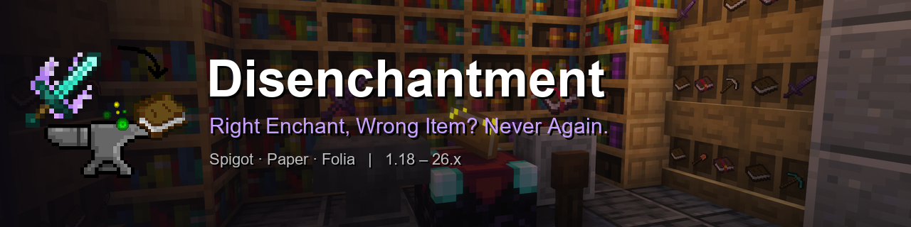
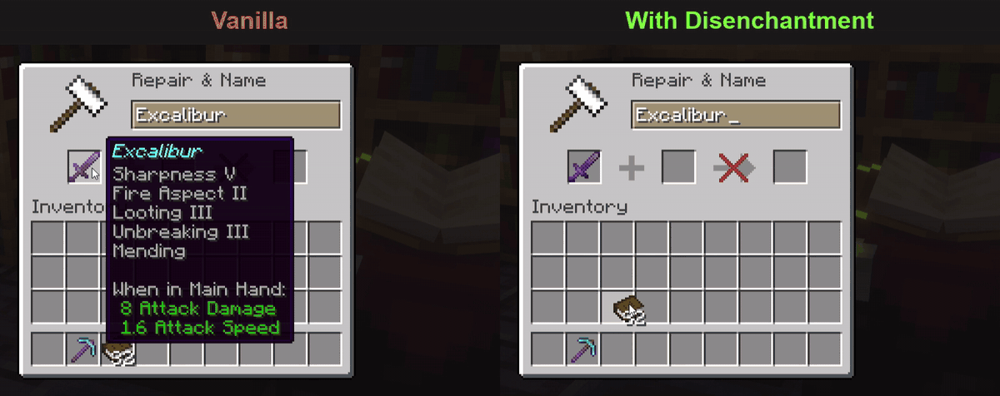
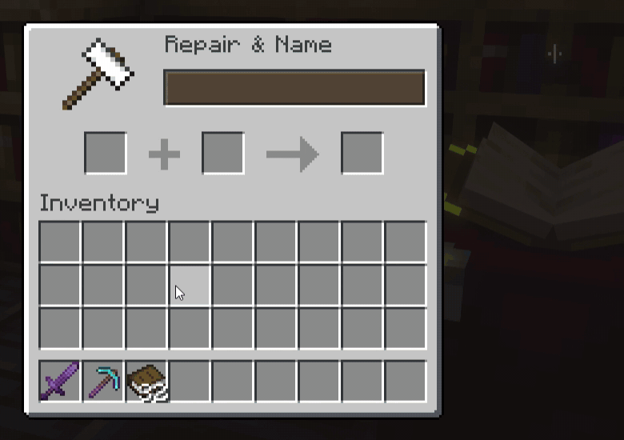
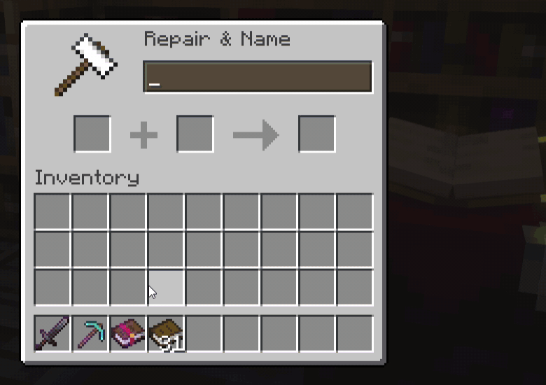
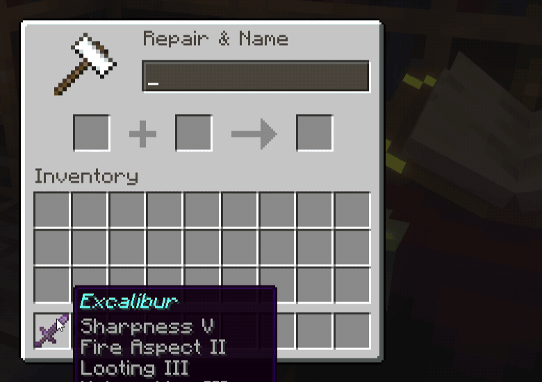
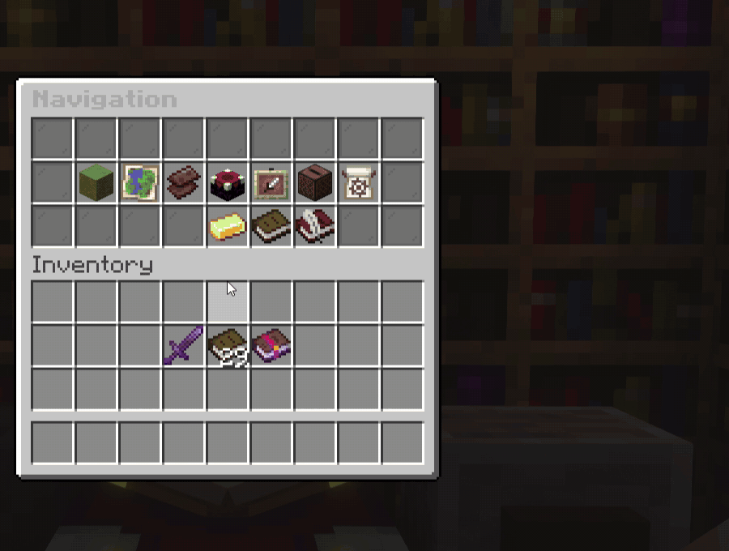

**Right enchant, wrong item? Never again.** Disenchantment lets players pull enchantments off items and split
enchanted books, using nothing but the vanilla anvil. No new blocks, no player menus, no resource pack. Drop the jar in
and it works on **Spigot, Paper and Folia**, from **Minecraft 1.18 to 26.x**.

## ✨ Disenchant items onto books

Put an enchanted item in the first anvil slot and a plain book in the second. Every enchantment moves onto the book and
the item comes back clean. Works on swords, tools, armor and anything else enchantable.

## 📖 Split enchanted books

Put a multi-enchantment book in the first slot and a plain book in the second. One enchantment splits off onto the new
book and the original keeps the rest, so you can apply exactly the enchantment you want.

## 🎛️ Decide what each enchantment does

Set any enchantment to one of four states:

- **enable**: transfers to the book
- **keep**: stays on the item
- **delete**: destroyed
- **disable**: blocks the operation

Group enchantments and change a whole group at once.

## 🖥️ Configure everything in-game

`/disenchantment gui` opens an admin panel for every setting:

- worlds, enchantments and materials
- XP cost and sounds
- economy and split count
- live statistics

Changes save instantly, with no restart and no YAML editing.

## 🔧 Everything else

- **XP cost formula**: `base + level × multiply`, with per-enchantment overrides, a max cost, an optional "Too Expensive!" bypass and a repair-cost reset
- **Economy**: an optional currency cost per operation (Vault / VaultUnlocked), previewed in the action bar
- **Restrictions**: allowlist or denylist per world and per material, set separately for disenchanting and splitting
- **Success chances**: give enchantments a transfer chance; a failed roll destroys that enchantment
- **Cooldowns**: built-in, or handled by CMI or EssentialsX
- **VIP discounts**: XP multiplier from LuckPerms meta or `disenchantment.discount.<N>` permissions
- **Statistics**: an optional SQLite log of every operation, viewable in-game
- **Developer API**: cancellable `Pre*` / `Post*` events with XP and economy cost, plus PlaceholderAPI placeholders
- **Languages**: English and Czech

## 🧩 Custom enchantment plugins

These enchantment plugins work out of the box:

- **AdvancedEnchantments**, **EcoEnchants**, **EnchantsSquared**, **UberEnchant** (all versions)
- **ExcellentEnchants**, **Vane**, **Zenchantments** (1.21+)

## 🚀 Installation

1. Download the jar and put it in `plugins/`.
2. Restart the server.
3. That's it. Tune it later with `/disenchantment gui`.

**Requirements:**

- Spigot, Paper or Folia, Minecraft 1.18 – 26.x
- Java 17+ (Java 21+ on 1.20.5 and newer)
- Optional: Vault, PlaceholderAPI, LuckPerms, CMI, EssentialsX

## 📚 Links

- [Documentation](https://github.com/H7KZ/Disenchantment/tree/master/docs/user)
- [Commands](https://github.com/H7KZ/Disenchantment/blob/master/docs/user/COMMANDS.md)
- [Permissions](https://github.com/H7KZ/Disenchantment/blob/master/docs/user/PERMISSIONS.md)
- [Config](https://github.com/H7KZ/Disenchantment/blob/master/docs/user/CONFIG.md)
- [FAQ](https://github.com/H7KZ/Disenchantment/blob/master/docs/user/FAQ.md)
- [Source code](https://github.com/H7KZ/Disenchantment)
- [Report a bug](https://github.com/H7KZ/Disenchantment/issues)

Found a bug? Run `/disenchantment diagnostic` and paste the result into a GitHub issue.

